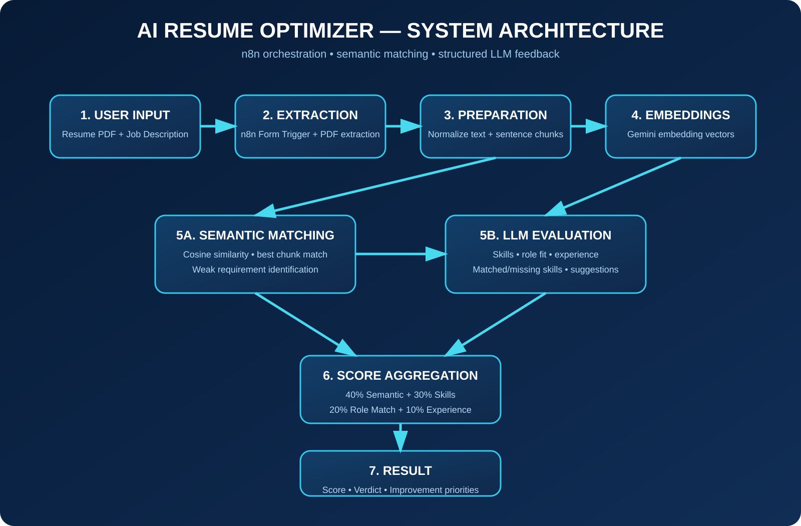

# AI Resume Optimizer

An AI-assisted resume evaluation workflow built using **n8n, Google Gemini, embeddings, cosine similarity, JavaScript, and PDF text extraction**. The system compares a candidate's PDF resume with a target job description, identifies semantically related and weakly matched requirements, evaluates skills and role alignment, and returns a weighted suitability score with actionable improvement suggestions.

---

## Project Overview

The **AI Resume Optimizer** is designed to make preliminary resume-to-job-description comparison more accessible and consistent.

Instead of manually comparing every resume section with a job description, users submit a PDF resume and the target job description through an n8n form. The workflow extracts and prepares the text, creates embeddings, performs semantic matching, obtains structured LLM feedback, and calculates an overall score.

The result is an advisory assessment. It is not a hiring decision, a guarantee of ATS performance, or proof that a candidate possesses a skill.

## Objectives

- Accept a resume PDF and job description through an n8n form.
- Extract readable text from the uploaded PDF.
- Clean and normalize resume and job-description text.
- Divide text into sentence-based chunks.
- Generate embeddings for resume and JD chunks.
- Compare chunks using cosine similarity rather than exact keyword matching alone.
- Identify weakly matched job requirements.
- Evaluate skills, role alignment, experience, and project descriptions using an LLM.
- Generate matched skills, missing skills, rewrite suggestions, and priorities.
- Calculate a transparent weighted suitability score.
- Return a human-readable verdict and improvement feedback.

---

## System Architecture

The project follows a modular workflow architecture in which n8n connects document processing, JavaScript logic, and Gemini API calls.

### Workflow Pipeline

1. **User Input:** Accepts a PDF resume, job description, and optional target role.
2. **Form Trigger:** Collects the form submission.
3. **PDF Text Extraction:** Extracts readable text using the Extract From File node.
4. **Text Preparation:** Normalizes whitespace and divides both documents into sentence-based chunks.
5. **Embedding Generation:** Sends resume and job-description chunks to Gemini Embeddings.
6. **Cosine Similarity:** Compares each job-description chunk against all resume chunks and retains the best match.
7. **Weak Requirement Identification:** Flags JD chunks below the initial similarity threshold.
8. **LLM Evaluation:** Evaluates skills, role match, experience, and project relevance.
9. **Structured Result:** Returns predictable JSON fields for downstream processing.
10. **Final Score:** Combines semantic and LLM scores using the weighted formula.
11. **Result Presentation:** Displays the overall score, verdict, evidence, and recommendations.

### Architecture Diagram

The system consists of five major stages:

- Input and PDF Extraction
- Text Preparation and Chunking
- Embedding Generation and Semantic Matching
- LLM Evaluation and Score Aggregation
- Result Presentation



---

## Technologies Used

| Technology | Purpose |
|---|---|
| n8n | Workflow automation and orchestration |
| Google Gemini Embeddings | Converts text chunks into numerical vectors |
| Gemini 2.5 Flash | Contextual resume and JD evaluation |
| JavaScript | Text preparation, cosine similarity, and score calculation |
| HTTP Request | Connects n8n to Gemini API endpoints |
| Extract From File | Extracts text from PDF resumes |
| JSON | Structures the AI evaluation output |

---

## Core Modules

### 1. Resume Input Module

- Accepts a PDF resume.
- Collects the target job description.
- Optionally captures the target role.
- Uses required form fields to reduce incomplete submissions.

### 2. PDF Extraction Module

- Extracts text from a text-based PDF.
- Passes extracted content to the preparation stage.
- Stops with a clear error if no readable text is returned.
- Scanned PDF OCR is a future extension and is not included in the core workflow.

### 3. Text Preparation Module

- Normalizes Unicode text and whitespace.
- Removes non-printable control characters.
- Splits resume and JD text into groups of approximately three sentences.
- Retains cleaned full text and chunk arrays for later analysis.

### 4. Embedding and Semantic Matching Module

- Generates vectors for resume and JD chunks.
- Separates vectors using the resume chunk count.
- Calculates cosine similarity for each JD chunk against all resume chunks.
- Selects the highest-scoring resume chunk.
- Calculates an average semantic score.
- Flags weak requirements using an initial threshold of 0.45.

### 5. LLM Evaluation Module

- Evaluates skills, role alignment, and experience.
- Identifies matched and missing skills.
- Reviews project relevance.
- Produces specific rewrite suggestions and improvement priorities.
- Is instructed not to invent candidate experience.

### 6. Final Scoring Module

The final score uses the following formula:

`FinalScore = 0.40 × Semantic + 0.30 × Skills + 0.20 × RoleMatch + 0.10 × Experience`

| Score | Verdict |
|---|---|
| 80–100 | Strong Match |
| 60–79 | Moderate Match |
| 0–59 | Weak Match |

### 7. Result Presentation

The workflow returns:
- Overall suitability score and verdict.
- Semantic, skills, role-match, and experience scores.
- Matched and missing skills.
- Role and project feedback.
- Rewrite suggestions.
- Top improvement priorities.
- Weakly matched job-description requirements.

---

## Repository Structure

```text
AI-Resume-Optimizer/
│
├── workflow/
│   └── ai-resume-optimizer-workflow.json
│
├── screenshots/
│   ├── illustrative-result-mockup.html
│   └── README.md
│
├── documentation/
│   └── project-documentation.md
│
├── Codes/
│   ├── All node's codes.txt
│   ├── Prepare Data.js
│   ├── Calculate Semantic Similarity.js
│   └── Calculate Final Score.js
│
├── assets/
│   ├── ai-resume-optimizer-hero.png
│   └── system-architecture.svg
│
├── .env.example
├── .gitignore
└── README.md
```

---

## Visual Assets

### Project Illustration


### System Architecture


### Illustrative Result Mockup

Open `screenshots/illustrative-result-mockup.html` in a browser to view a sample result layout. It is explicitly an illustrative mockup, not a screenshot of a live n8n execution.

---

## Installation and Setup

### 1. Prerequisites

Before starting, make sure you have:

- An n8n instance (local installation or n8n Cloud).
- A Google AI Studio API key with access to the Gemini embedding and generation models.
- A text-based PDF resume for testing.

### 2. Clone the Repository

```bash
git clone https://github.com/YOUR_USERNAME/AI-Resume-Optimizer.git
cd AI-Resume-Optimizer
```

Replace `YOUR_USERNAME` with your GitHub username.

### 3. Start n8n

You can use n8n Cloud or a local instance.

To install and start n8n locally:

```bash
npm install -g n8n
n8n
```

Open:

```text
http://localhost:5678
```

### 4. Configure Gemini API Access

1. Obtain an API key from Google AI Studio.
2. Configure `GEMINI_API_KEY` in the environment where n8n runs.
3. The workflow uses the environment expression `{{$env.GEMINI_API_KEY}}` in its HTTP Request nodes.
4. If your n8n deployment restricts environment-variable access, configure a credential-backed header instead.
5. Never commit your real API key to GitHub.

See `.env.example` for the variable name only.

### 5. Import the Workflow

1. Open your n8n instance.
2. Navigate to Workflows.
3. Select Import from File.
4. Choose `workflow/ai-resume-optimizer-workflow.json`.
5. Review all imported nodes.
6. Check the Form Trigger binary property name and ensure it matches the Extract From File node.
7. Confirm that the Gemini API key expression is permitted by your n8n configuration.
8. Save the workflow.

**Important:** n8n node versions and form configuration options can vary. Verify the imported form and completion nodes in your n8n version before running the workflow.

### 6. Verify Workflow Configuration

Before execution:

- Confirm that the PDF upload field is mapped to the correct binary property.
- Confirm that the Extract From File node returns a text field.
- Check that the Prepare Data node references the correct Form Trigger node name.
- Verify the Gemini embedding endpoint and response structure.
- Verify the Gemini generation endpoint and JSON response.
- Confirm the environment variable or credential is configured.
- Check that the final form response displays the result.

### 7. Execute the Workflow

1. Save and activate or test the workflow.
2. Open the Form Trigger test URL.
3. Upload a text-based PDF resume.
4. Paste the job description.
5. Optionally enter the target role.
6. Submit the form.
7. Inspect the execution data at each node.
8. Review the final suitability score and recommendations.

---

## Example Usage

A user can submit a job description such as:

```text
We are looking for a junior software developer with knowledge
of JavaScript, React, Node.js, REST APIs, databases, and Git.
The candidate should be able to develop and maintain web
applications and work with a team.
```

The workflow then:

1. Extracts the candidate's resume text.
2. Cleans and chunks the resume and job description.
3. Generates embeddings.
4. Finds the best semantic match for each job-description chunk.
5. Identifies weakly matched requirements.
6. Asks Gemini to evaluate skills, role alignment, and experience.
7. Calculates the final weighted score.
8. Returns the verdict and improvement suggestions.

---

## Troubleshooting

| Problem | Possible Solution |
|---|---|
| PDF extraction returns no text | Use a text-based PDF or add an OCR service for scanned PDFs. |
| Binary property not found | Inspect Form Trigger output and update Extract From File's binary property name. |
| Gemini authentication fails | Verify the API key and n8n environment configuration. |
| Embedding count mismatch | Check chunk arrays and the Gemini batch embedding response. |
| Similarity calculation fails | Check for empty arrays, missing vectors, or mismatched dimensions. |
| LLM output is invalid JSON | Inspect the Gemini response and confirm JSON response mode. |
| Final score is missing | Verify the names and output structures used by the Code nodes. |
| API quota or timeout error | Check account limits and configure suitable retries. |

---

## Security

- No API key is included in this repository.
- Store credentials in n8n Credentials or secure environment variables.
- Never commit `.env` files, tokens, passwords, or private resume documents.
- Avoid logging full resume contents.
- Apply suitable execution-data retention settings.
- Obtain consent before processing personal resume information.
- Review workflow exports before publishing them.

---

## Limitations

- The current workflow is designed for one resume and one job description per run.
- Text extraction is designed for text-based PDFs.
- Scanned PDF OCR is not included.
- The 0.45 semantic threshold is an initial value and needs calibration.
- The scoring weights are design parameters, not empirically validated performance measures.
- Semantic similarity does not prove that a candidate possesses a skill.
- LLM feedback may be subjective or misinterpret ambiguous resume statements.
- The result is advisory and should not be used as the sole basis for hiring decisions.

---

## Future Scope

- Add OCR support for scanned PDF resumes.
- Support DOCX resume uploads.
- Add resume rewriting while preserving factual accuracy.
- Provide before-and-after resume score comparison.
- Add ATS formatting and section checks.
- Create an anonymized evaluation dataset to calibrate scores and thresholds.
- Compare Gemini, OpenAI, and Ollama for quality, latency, cost, and privacy.
- Add consent, retention limits, secure deletion, and access control.

---

## Project Status

This repository includes an n8n workflow export, JavaScript node code, Gemini prompts, project documentation, and original illustrative visual assets. The workflow has not been executed against an external n8n instance or API credentials in this environment. Import and validate the workflow in your own n8n version before treating it as deployment-ready.

The sample score and result page are illustrative only. No measured accuracy or performance claim is made.
